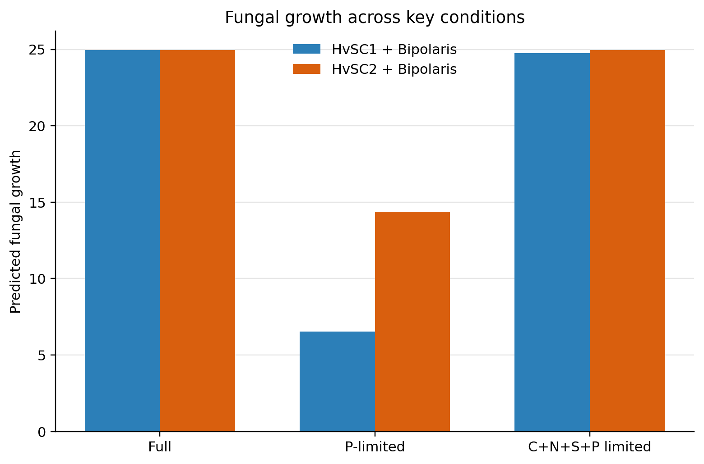
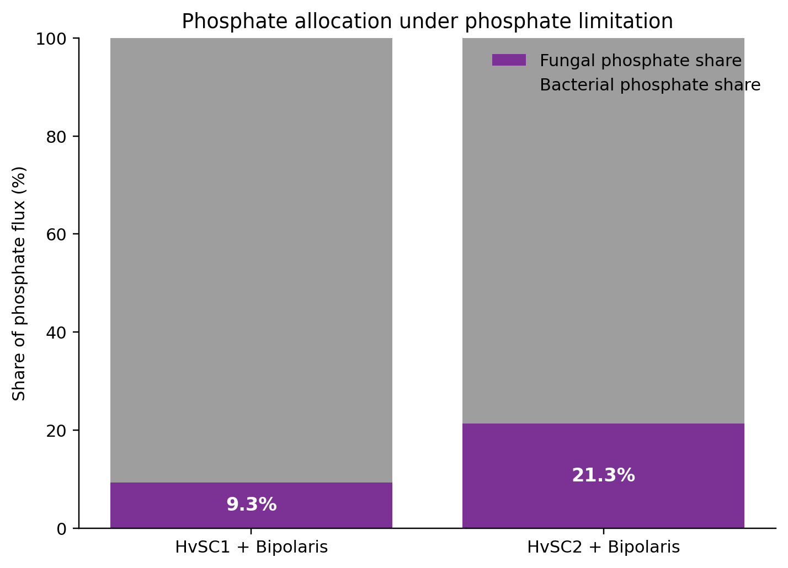
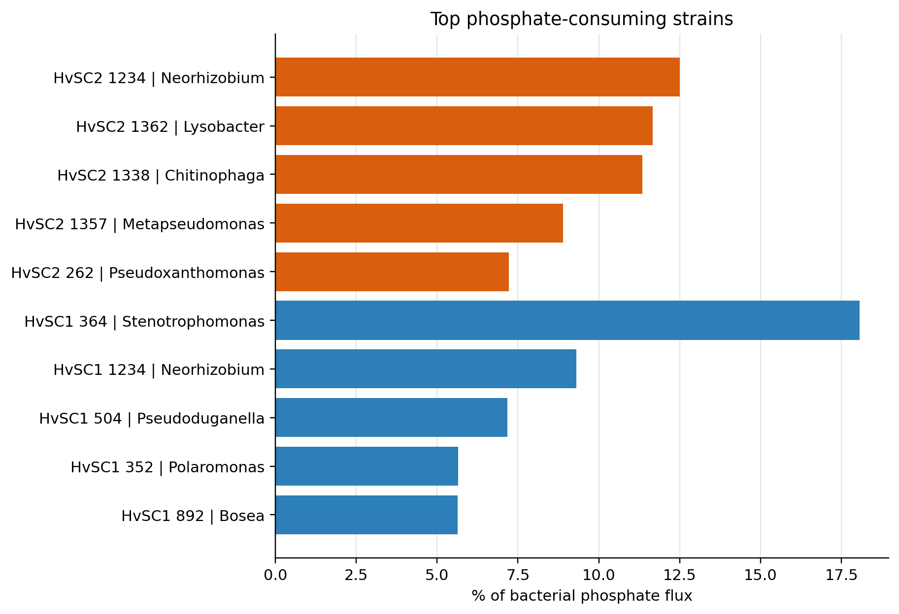
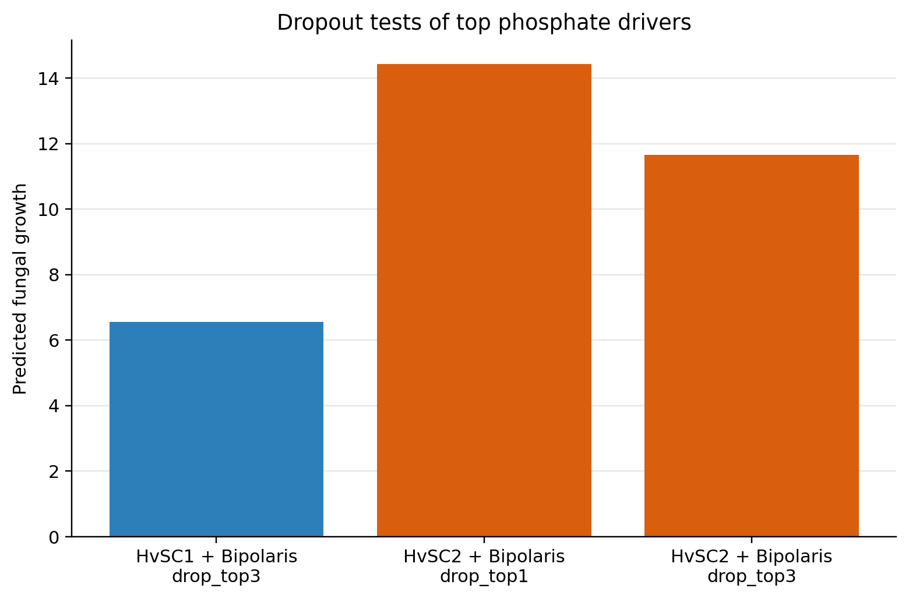
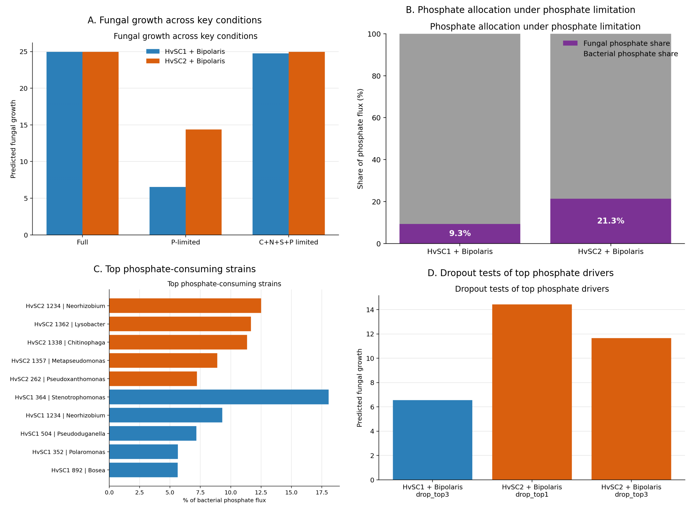
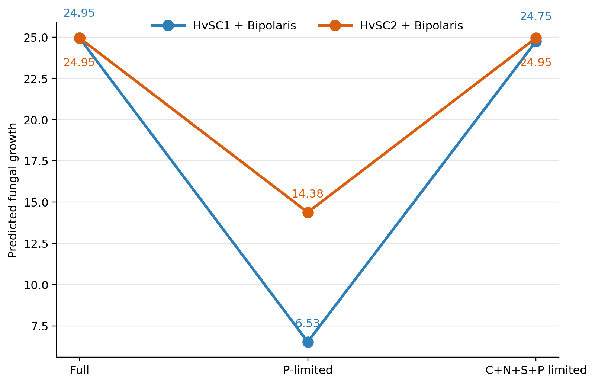
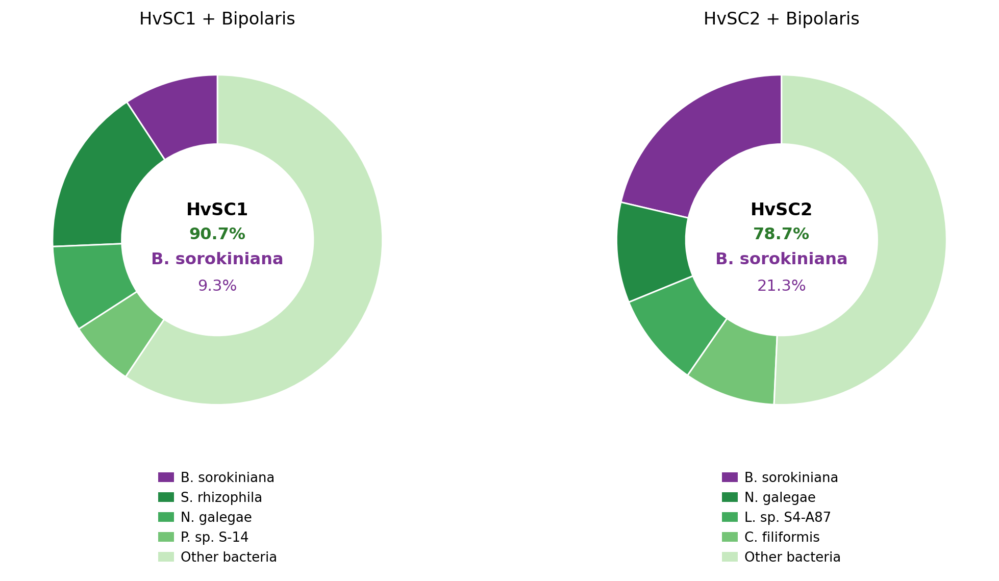
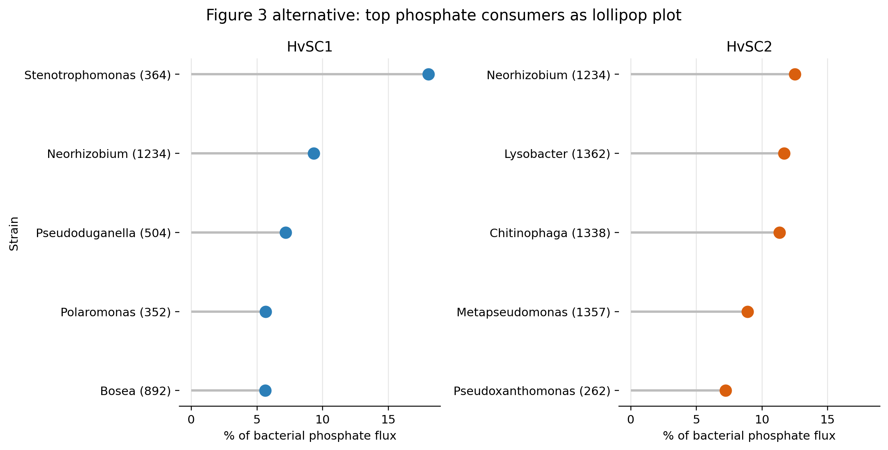
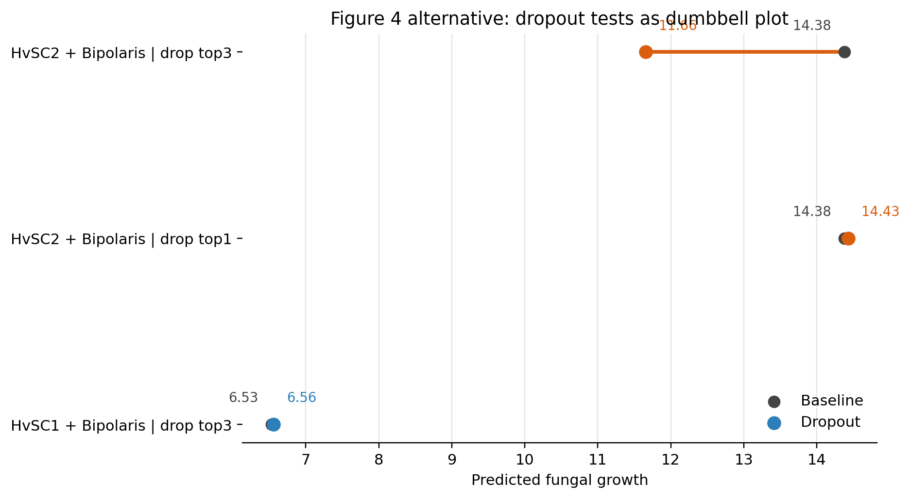

# Phosphate MICOM Results Summary

Generated on 2026-09-01.

## Figure 1. Fungal growth across key conditions

Predicted *Bipolaris sorokiniana* growth in HvSC1 and HvSC2 under full medium,
phosphate-limited medium, and combined carbon-, nitrogen-, sulfur-, and
phosphate-limited medium. Under the full medium, fungal growth was nearly
identical in the two communities (`24.95` in HvSC1
and `24.95` in HvSC2). The strongest separation
appeared under phosphate limitation, where fungal growth decreased to
`6.53` in HvSC1 and `14.38`
in HvSC2. Under combined source limitation, fungal growth recovered to
`24.75` in HvSC1 and
`24.95` in HvSC2, indicating that
phosphate-only restriction produced the clearest difference between the two
communities.

## Figure 2. Phosphate allocation under phosphate limitation

Abundance-normalized allocation of phosphate uptake under the
phosphate-limited condition. In HvSC1, the fungal member accounted for only
`9.3%` of the modeled phosphate uptake,
whereas in HvSC2 it accounted for `21.3%`.
The lower fungal phosphate share in HvSC1 is consistent with stronger modeled
competition for phosphate and provides a mechanistic explanation for the lower
fungal growth observed in Figure 1.

## Figure 3. Top phosphate-consuming strains in each SynCom

Relative contributions of the main bacterial phosphate consumers under
phosphate limitation. In HvSC1, the largest contributors were strain 364
(*Stenotrophomonas rhizophila*), strain 1234 (*Neorhizobium galegae*), and
strain 504 (*Pseudoduganella* sp. S-14), which together accounted for 34.5% of
the bacterial phosphate allocation. In HvSC2, the largest contributors were
strain 1234 (*Neorhizobium galegae*), strain 1362 (*Lysobacter* sp. S4-A87),
and strain 1338 (*Chitinophaga filiformis*), together accounting for 35.5%.
These results indicate that the phosphate-demand phenotype is distributed
across several community members rather than being driven by a single dominant
strain.

## Figure 4. Dropout tests of top phosphate-consuming strains

Effect of removing the strongest phosphate-consuming bacterial strains from the
phosphate-limited community simulations. In HvSC1, removal of the top three
candidate strains produced only a minimal increase in fungal growth
(`6.56` versus `6.53`
in the original phosphate-limited condition). In HvSC2, removal of the top
strain caused only a small change (`14.43` versus
`14.38`), whereas removal of the top three strains
reduced fungal growth to `11.66`. Together, these
results support a distributed community-level effect rather than a simple
single-strain rescue mechanism.

## Combined gallery

## Generated alternative graphics

### Figure 1 alternative

This alternative slope plot emphasizes how the fungal phenotype changes across
the tested nutrient regimes. Under the full medium, predicted
*B. sorokiniana* growth was essentially identical in the two mixed communities
(`24.95` in HvSC1 and `24.95` in HvSC2), indicating that under nutrient-rich
conditions the two SynComs exerted little differential effect on the fungal
member. The clearest separation emerged under phosphate limitation, where
fungal growth decreased strongly in both communities but much more severely in
HvSC1 (`6.53`) than in HvSC2 (`14.38`). This identifies phosphate limitation as
the condition under which the contrasting metabolic behavior of the two SynComs
becomes most visible.

The combined source-limited condition provides an important comparison. When
carbon, nitrogen, sulfur, and phosphate were reduced together, fungal growth
recovered to `24.75` in HvSC1 and `24.95` in HvSC2, nearly matching the full
medium condition. This indicates that the strong HvSC1-specific fungal penalty
was not simply a generic response to broad nutrient restriction. Instead, it
supports the interpretation that the phosphate-only condition exposed a more
specific competition pattern that was partially masked when multiple resources
were constrained simultaneously.

One possible explanation is that, under phosphate limitation alone, bacterial
members in HvSC1 are able to capture a larger share of the available phosphate
pool, thereby reducing the proportion of phosphate flux assigned to
*B. sorokiniana*. In contrast, when several major nutrients are limited at the
same time, the bacterial community may itself become constrained by carbon,
nitrogen, or sulfur availability, which reduces its capacity to dominate
phosphate acquisition. Under that scenario, fungal access to phosphate is
effectively less suppressed, allowing fungal growth to recover despite the
overall harsher medium.

These results should still be interpreted cautiously. The analysis does not
prove that HvSC1 experimentally suppresses fungal growth through phosphate
competition, nor does it show that phosphate is the only mechanism operating in
the system. Rather, it identifies a robust modeling pattern: among the tested
resource limitations, phosphate restriction generated the strongest divergence
between HvSC1 and HvSC2, and that divergence was associated with lower
predicted fungal growth in HvSC1. This makes phosphate competition a plausible
mechanistic hypothesis for subsequent strain-level and interaction-focused
analyses.

### Figure 2 alternative

This alternative donut representation resolves the phosphate partitioning in
greater detail. In HvSC1, the SynCom captured `90.7%` of the modeled phosphate
uptake capacity, leaving only `9.3%` to *B. sorokiniana*. Within the HvSC1
bacterial share, the largest contributors were *S. rhizophila* (`16.4%` of
total community phosphate uptake), *N. galegae* (`8.4%`), and
*Pseudoduganella* sp. S-14 (`6.5%`), with the remainder assigned to other
bacterial members. In HvSC2, the SynCom share was lower (`78.7%`) and the
fungal share was correspondingly higher (`21.3%`). The largest bacterial
contributors in HvSC2 were *N. galegae* (`9.8%`), *Lysobacter* sp. S4-A87
(`9.2%`), and *C. filiformis* (`8.9%`). Together, these values indicate that
HvSC1 allocates a larger fraction of the phosphate pool to bacterial members
than HvSC2, which is consistent with the lower predicted fungal growth of
*B. sorokiniana* under phosphate limitation.

### Figure 3 alternative

### Figure 4 alternative

